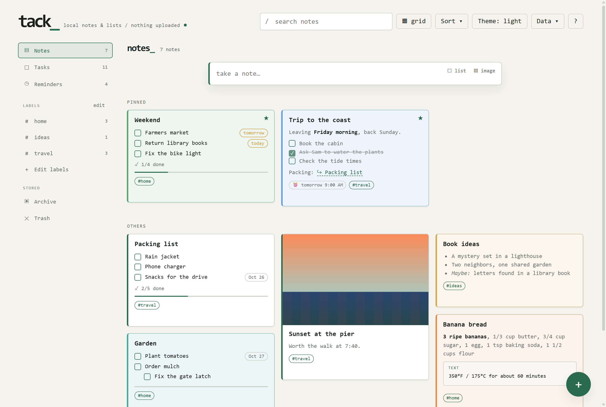
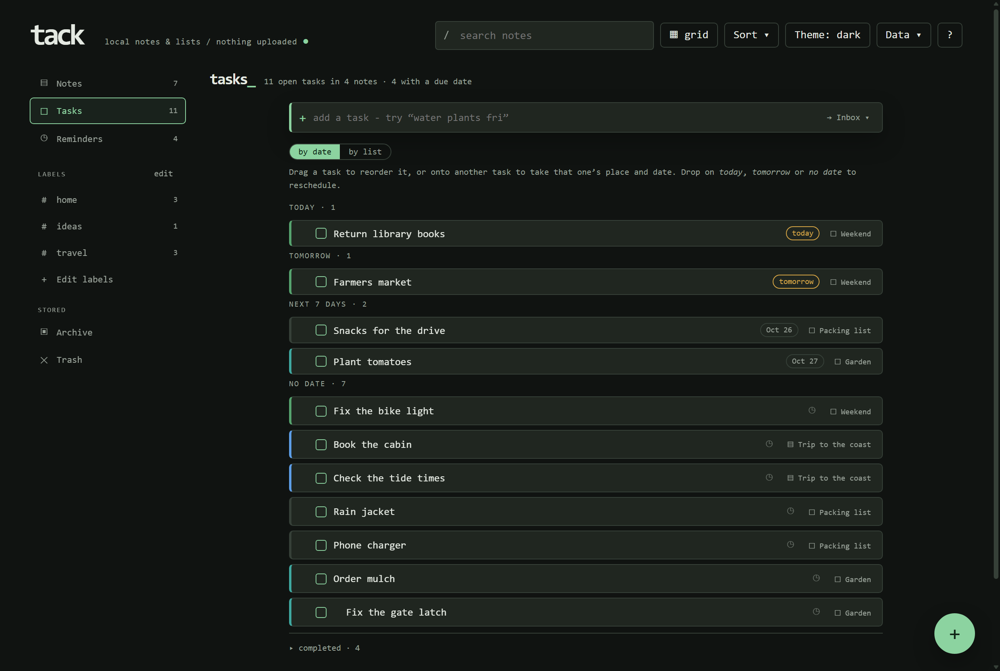
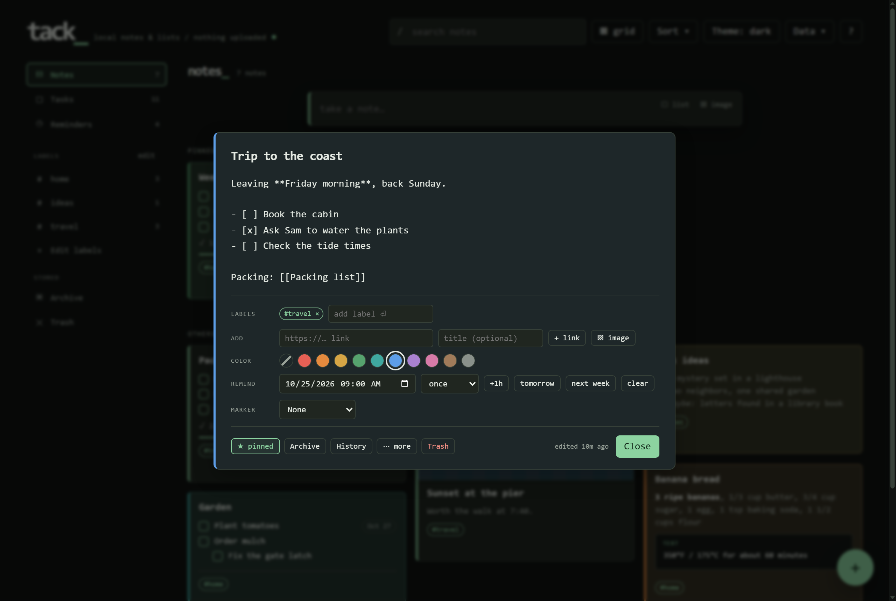
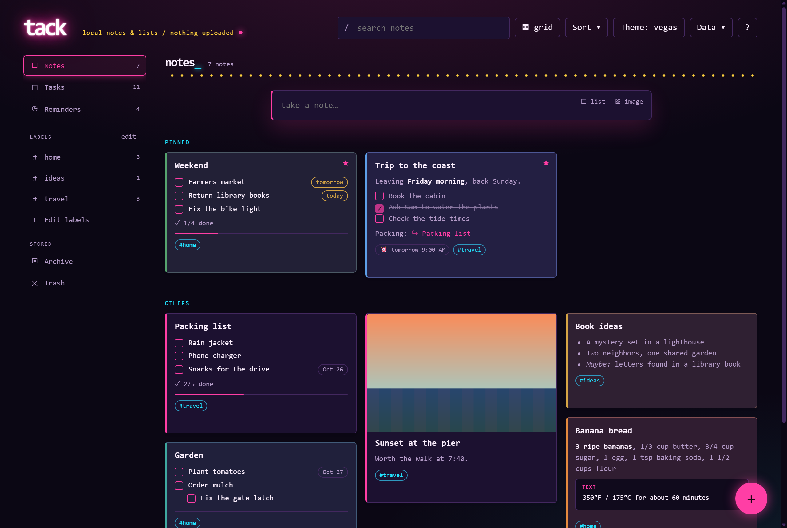
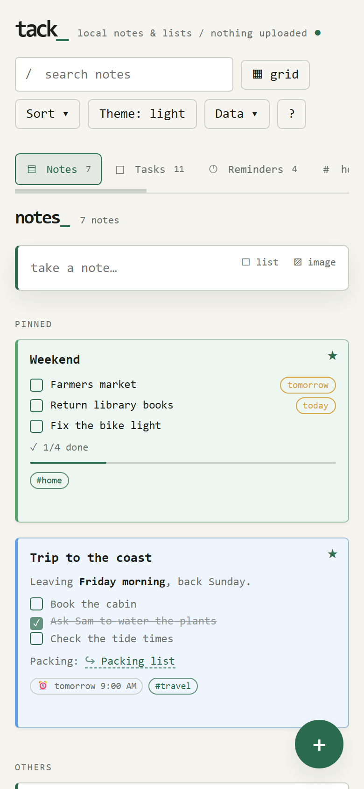

# Tack

Notes, checklists and tasks in a single HTML file. Everything stays in your browser: no account, no server storing your notes, nothing uploaded.



## Using it

- **Online:** open **https://tack.radmagelabs.com/**. It's the same app, and your notes still stay in your browser.
- **As a file:** download `tack.html` and open it in your browser. That's the whole app.
- **From a web server:** serve this folder with any static file server, for example `python -m http.server 8000`, and open `http://localhost:8000/tack.html`. Served this way, picture-text search loads its reader from the `vendor/` folder beside the page instead of from a CDN.

Press `?` in the app for help and shortcuts, and `ctrl`+`k` for the command bar.

## What it does

- **Notes and checklists** with Markdown on the cards (bold, italic, code, fenced code blocks, clickable `- [ ]` checkboxes, links). Checklists support indenting, drag to reorder and pasting multi-line lists.
- **Tasks:** every unchecked item from every note in one view, grouped by due date or by list. Type "water plants fri" to set the date as you add one.
- **Reminders** with repeats, and due dates on checklist items.
- **Labels, colors, pins, archive and trash** (trash empties itself after 30 days). Search operators include `#label`, `is:list`, `has:image`, `due:week` and `-word`.
- **`[[Note links]]`** with autocomplete and backlinks. Renaming a note offers to update the links to it.
- **History:** every editing session keeps the version before it; the last 25 can be compared and restored.
- **Templates** with `{{date}}`, `{{time}}` and `{{weekday}}`.
- **Pictures:** paste, drop or pick them, view them full size, and mark them up with arrows, boxes, highlights, pen, text and pixelation. Large photos are scaled down; screenshots are kept as they are.
- **Picture-text search** (optional, off until you turn it on): reads the text inside screenshots so search can find it.
- **Locked notes:** a note's text and checklist can be encrypted with a password (AES-GCM).
- **Imports:** Google Keep (Takeout), email (`.eml` and Outlook `.msg`), and Tack's own backups. **Exports:** a full JSON backup, or Markdown with the pictures in a `.zip`.
- **Quick capture**, a command bar, bulk select (merge, print, label), a pop-out window that stays on top (Chrome and Edge), and undo/redo.
- **Themes:** light, dark, Vegas, or follow the system.



| | |
|---|---|
|  |  |



## Where your notes live

In the browser you open Tack in, under that page's address:

- **localStorage:** your notes, labels and templates (`tack_state`), settings (`tack_prefs`) and theme (`tack_theme`).
- **IndexedDB** (a database named `tack`): pictures, note history, automatic snapshots, and any saved data Tack found but couldn't read.

So the same notes do **not** appear in another browser, another browser profile, a private window, or Tack opened from a different address. Firefox also treats each file path separately, so moving or renaming `tack.html` there opens an empty board: export a backup first and import it afterward. Clearing the browser's data for the page deletes the notes.

Data saved under the app's earlier name, `taskman`, is copied over automatically the first time Tack runs in the same place. The old copy is left untouched.

## Backups

Tack's storage is the only copy unless you make another:

- **Data > Export backup** saves everything, pictures included, as one `.json` file. **Data > Import backup** restores it, either merging with what's there or replacing it.
- **Data > Backups** takes automatic snapshots inside the browser (daily by default) that you can restore or download. They protect against mistakes, not against clearing browser data.
- In Chrome and Edge, **Data > Save to file** keeps a `.json` file on your disk in sync automatically, and a **backup folder** gets full copies with each snapshot.
- A snapshot is taken before anything replaces notes: replacing an import, restoring a snapshot, opening a file, or a merge that would overwrite notes with the same id.
- A gold dot on **Data** means nothing has been saved outside the browser for a week.

If storage fills up or is blocked, a warning stays on screen until saving works again, so you never think something was saved when it wasn't. If saved data can't be read, Tack keeps it as found, writes nothing over it, and lets you download it, restore a snapshot, import a backup or start fresh.

## Privacy and network use

Tack has no account, no analytics, no tracking and no cookies, and it never sends your notes anywhere. It makes no network requests other than these, each of which you start:

| What | When | Where it connects |
|---|---|---|
| Picture-text search, served from a website | Only after you turn it on, the first time it runs | The same website (`vendor/`), nowhere else |
| Picture-text search, `tack.html` opened as a file | Only after you turn it on, the first time it runs | cdn.jsdelivr.net, for the pinned reader files (about 4.4 MB) |
| A link inside a note | When you click it | That link, in a new tab |

The pictures themselves are read inside your browser and never uploaded. If the reader can't load or start, a warning says why and offers Retry; it never just spins. A backup folder synced by a cloud service (OneDrive, Dropbox, iCloud Drive and so on) means that service stores copies of your notes.

Security details, including what locked notes do and don't protect: [SECURITY.md](SECURITY.md).

## Browser support

Tested with Chrome 155 and Edge 155 on Windows (the full test suite, as a file and served over http) and Firefox 148 (a smoke test of the essentials, as a file and served over http). Based on the browser features it uses, it should work in Chromium 111 or newer, Firefox 113 or newer and Safari 16.4 or newer, but **Safari has not been tested**. Older Safari versions can't run it at all.

Chrome and Edge only: the autosaved file, the backup folder, opening a file to keep in sync, and the pop-out window. Elsewhere those menu items are hidden. Copying pictures to the clipboard needs Firefox 127 or newer.

## Known limitations

- Reminders fire only while a Tack tab is open.
- Reordering by drag and drop probably doesn't work with touch on phones (not yet verified).
- Locked notes encrypt the text and checklist only. The title, labels, color and pictures are not encrypted, and a forgotten password can't be recovered. Snapshots, history and backups made before a note was locked still hold its readable text.
- Pixelating part of a picture changes the saved picture, but the original stays in snapshots, history and older backups.
- An SVG picture is stored as a PNG copy, so its vector detail isn't kept.
- The automatic backup folder keeps only the newest copies; older `tack-backup-*.json` files there beyond the number you choose to keep are deleted.

## Development

Tack is plain HTML, CSS and JavaScript: `tack.html` is the whole app, and nothing compiles it. The tests need Node 22.2 or newer and Chrome or Edge:

```
node tests/run.mjs              # everything that works offline
node tests/run.mjs --file       # the same, with tack.html opened as a file
node tests/run.mjs --package    # against the website package, with its production headers
node tests/run.mjs --ocr        # adds picture-text search against the real CDN
node tests/firefox-smoke.mjs    # the essentials in Firefox
```

For a website, `node tools/package.mjs` copies `tack.html` and the reader's files into `dist/` after checking every vendored file's hash; only `dist/` is served. See [docs/TESTING.md](docs/TESTING.md) for what is covered and what isn't, and [docs/DEPLOYMENT.md](docs/DEPLOYMENT.md) for hosting.

## Credits

Made by RadMageIrl. Picture-text search uses [tesseract.js](https://github.com/naptha/tesseract.js) and its English recognition data (Apache License 2.0). See [THIRD-PARTY-NOTICES.md](THIRD-PARTY-NOTICES.md). Google Keep and Outlook are named only to describe what Tack can import.

## License

Tack is free software under the **GNU General Public License, version 3 or later** (GPL-3.0-or-later): you may use, study, share and change it under those terms. See [LICENSE](LICENSE). The picture-text reader in `vendor/` is separate software under its own licenses (mainly Apache 2.0, which is compatible with the GPL version 3); see [THIRD-PARTY-NOTICES.md](THIRD-PARTY-NOTICES.md).
